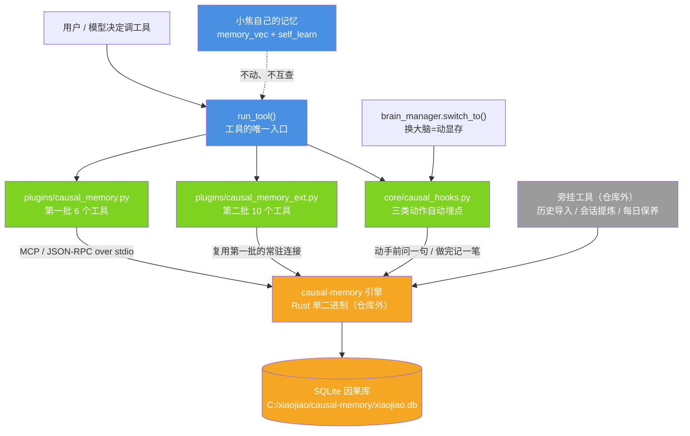

# 因果记忆（causal-memory 集成）

| 项 | 值 |
| --- | --- |
| 适用版本 | v1.0 |
| 最后更新 | 2026-10-15 |
| 维护者 | 小焦项目 |
| 文档状态 | 可用（引擎本身是 alpha，见「已知问题」） |

**摘要**：小焦自己已经有记忆（事实/画像/经验），缺的是**因果教训**这一层：
「这个动作以前造成过什么后果」「这类事我踩过什么坑」。
本文说明怎么把外部引擎 [causal-memory](https://github.com/JingxuanC/causal-memory)
接进来当这一层用 —— **不改主程序一行代码**，插件目录丢两个文件即生效；
同时也说清哪些东西**故意留在仓库外面**。

## 目录

1. [为什么这么分层](#1-为什么这么分层)
2. [结构图](#2-结构图)
3. [两个插件各给什么（16 个工具）](#3-两个插件各给什么16-个工具)
4. [怎么装](#4-怎么装)
5. [自动埋点埋在哪三类动作上](#5-自动埋点埋在哪三类动作上)
6. [仓库外面还有什么（旁挂工具）](#6-仓库外面还有什么旁挂工具)
7. [实测数据](#7-实测数据)
8. [已知问题（不粉饰）](#8-已知问题不粉饰)

---

## 1. 为什么这么分层

小焦里已经有的记忆，**一条都不动**：

| 小焦自己有的 | 负责什么 |
| --- | --- |
| `core/memory_vec.py` 记忆向量库 | 事实、用户画像、偏好 |
| `self_learn/` 学习库 | 经验记录（谁用了什么工具、成功还是失败、下次该怎么做） |
| 来源分层 / 写入侧去重 / 隔离区 / 时间衰减 / 精排 | 记忆治理 |

causal-memory 补的是这些**小焦没有**的：类型化的因果边（caused / enabled / prevented）、
**动手前的抑制侧预警**、反事实对比、多跳故障溯源、预测账本、图结构体检。

两套记忆**不互相查**（这是刻意的）：小焦的回答链路仍走它自己的记忆；
因果工具是模型可以主动调的一层。合成一套要改小焦的检索链路，那是另一件事，也是另一个决定。

## 2. 结构图



图里绿框的三个文件是**仓库里的东西**（两个插件 + 一个埋点模块），
橙框是**外部引擎与它的库**，灰框是**故意留在仓库外面的旁挂工具**。

## 3. 两个插件各给什么（16 个工具）

第一批 `plugins/causal_memory.py`（6 个）——「动手前后 + 查教训」：

| 工具 | 用途 |
| --- | --- |
| `causal_warn` | 动手前预警：这个动作以前造成过什么后果（抑制侧） |
| `causal_search` | 查过去的教训：同类事情上什么做法导致了什么结果 |
| `causal_record` | 记一条「决策 → 结果」（relation 取 caused / enabled / prevented / co_occurrence） |
| `causal_trace` | 故障多跳溯源 |
| `causal_counterfactual` | 两个候选方案各自过去的结果分布 |
| `causal_report` | 预测账本：以前的判断押对了多少 |

第二批 `plugins/causal_memory_ext.py`（10 个）——「库的运维与深挖」：

| 工具 | 用途 |
| --- | --- |
| `causal_memory_map` | 库的全貌（多少边、多少节点、最近记了什么） |
| `causal_patterns` | 引擎挖出来的关系：相似 / 重复 / 矛盾 / 精化 |
| `causal_lesson` | 从多条散边重建一条可复用的教训 |
| `causal_unified` | 统一检索（它那边的事实层 + 因果层一起查） |
| `causal_invalidate` | 把一条错的教训**软作废**（可回滚，不是删除） |
| `causal_invalidate_pattern` | 把一条误判的关系软作废 |
| `causal_resolve` | LLM 评审「同一决策反复记、结局却不同」的发散项 |
| `causal_trace_one` | 单跳溯源 |
| `causal_remember` | 直接把一段对话喂进它的提炼链路 |
| `causal_facts` | 查它那边的事实层（与小焦自己的记忆是两套） |

（引擎一共 17 个工具，**`record_fact` 故意不接** —— 小焦自己有事实记忆，再来一套只会打架。）

## 4. 怎么装

1. 从该项目的 Releases 下载 `windows-x86_64` 包（约 5 MB，单二进制，**不需要 Rust 工具链**），
   解压到比如 `C:/xiaojiao/causal-memory/`；
2. 在 `xiaojiao_control.json` 里加一块：

```json
"causal_memory": {
  "exe": "C:/xiaojiao/causal-memory/causal-memory.exe",
  "db":  "C:/xiaojiao/causal-memory/xiaojiao.db",
  "task_tag": "小焦运维",
  "auto": true,
  "auto_kinds": ["config", "file", "vram"],
  "auto_min_interval_s": 600,
  "auto_max_per_hour": 30,
  "auto_show_related": true
}
```

3. 重启小焦。**找不到二进制时两个插件一个工具都不注册**（`get_tool_descriptions()` 返回空），
   不会给模型一堆点不动的工具；真去调会给一句中文说明，告诉你缺什么、去哪下。

## 5. 自动埋点埋在哪三类动作上

实现在 `core/causal_hooks.py`，挂点是 `run_tool()`（工具的唯一入口）与 `brain_manager.switch_to()`：

| 类别 | 认什么 |
| --- | --- |
| 配置类 | 写/改配置文件（`xiaojiao_control.json`、`llama-swap.y*ml`、`*.yaml|yml|toml|ini|conf|env`、`presets/*.json`），命令里带配置文件路径也算 |
| 文件类 | 写文件（`write_file`/`edit_file`/`append_file`/`save_to`）；命令里含删除/覆盖/移动 |
| 显存类 | 大脑切换（卸载/加载模型 = 显存里谁进谁出） |

只读类、搜索类一律不埋。动作**之前**问一句（最多等 2 秒，等不到就不说），
**之后**记一笔（丢后台线程，不挡用户）。只有对面明确给 `WARNING` / `DANGER` 才当预警；
`UNKNOWN`/空/超时不会说成危险，最多挂一句如实标注的参考。

## 6. 仓库外面还有什么（旁挂工具）

有一类东西**故意不进仓库**：把历史和小焦的会话导进因果库、每天做一次保养。
它们耦合的是 causal-memory 引擎（不是小焦），放在仓库里会让仓库变臃肿，
引擎升级换目录时还得跟着改 —— 那就违背了「解耦」。

它们在 `C:/xiaojiao/causal-memory/sidecar/`（**不在本仓库**），一共四件事：

| 脚本 | 干什么 |
| --- | --- |
| 历史导入 | 把小焦学习库里的经验（本机实测 414 条）一次性导进因果库，并持续增量导入 |
| 会话提炼 | 把小焦的会话转成引擎认的 turns 格式，让引擎用 LLM 提炼「决策 → 结果」 |
| 每日保养 | 极性回填 → 连链 → 图结构体检 → 发散评审 → 离线巩固 → 小批量提炼 → 导出快照 → 出日报 |
| 判官配置 | 把本机 llama-swap 配成引擎的判官（判成败/极性），并给足超时 |

想自己搭的话，照上面四件事写就行 —— 只读小焦的文件（学习库、会话 JSON），
写只写因果库和它自己的 `reports/` 目录。

**这一半已经单独开源**：[jiangchuangege/xiaojiao-causal-memory-sidecar](https://github.com/jiangchuangege/xiaojiao-causal-memory-sidecar)
（MIT）。单独一个仓库是有意的：它耦合的是引擎、不是小焦本体，
放进主仓库会变臃肿，引擎升级换目录时还得跟着改 —— 那不叫解耦。

## 7. 实测数据

* 只接插件、没导历史时：库里 6 条边，`causal_warn` 基本回 `UNKNOWN`（**等于没有预警**）；
* 导入 414 条历史经验后：**600+ 条活跃因果边**、300+ 条挖出来的关系、100+ 条事实；
  动作匹配上"历史上成功过"→ `✅ SAFE`，匹配上"历史上失败过"→ `⚠️ DANGER`（真机验过）；
* 「视频生成时把聊天模型装回显存 → 一段 81 帧从 15 分钟变 50 分钟」这条，
  是自动埋点记进去的（`causal_search` 能查回来）。

## 8. 已知问题（不粉饰）

1. **引擎的 `refute`（图结构体检）在千条边规模上会 panic**（退出码 101）—— 这是引擎自己的 bug
   （它目前是 0.9.3 alpha）；仓库里没有绕过它，只是不依赖它；
2. **极性不是条条都准**：用本地 4B 当判官时，它常在 JSON 后面多写一段解释，引擎解析不了就退回
   信号词启发式；不配判官时更粗（结果文案里带"成功/失败"才认得出）；
3. **没有语义检索**：引擎要一个 OpenAI 兼容的 embeddings 接口，本机 llama-swap 不带，所以只有 BM25；
4. **两套记忆不互查**（刻意的，见第 1 节）：想让小焦回答时也用上因果教训，得改它的检索链路 ——
   那属于"改项目"，不在当前范围内；
5. 自动埋点是**抽样**的：同一个动作 10 分钟内只记一次、每小时最多 30 条。

## 相关文档

- [插件开发指南](PLUGINS.md)：插件机制、契约与边界，以及本文这两个插件作为示例
- [工具清单](tools.md)：内置工具与插件工具的实际清单
- [扩展开发](extend.md)：改人设、加模型、把已有系统包成工具
